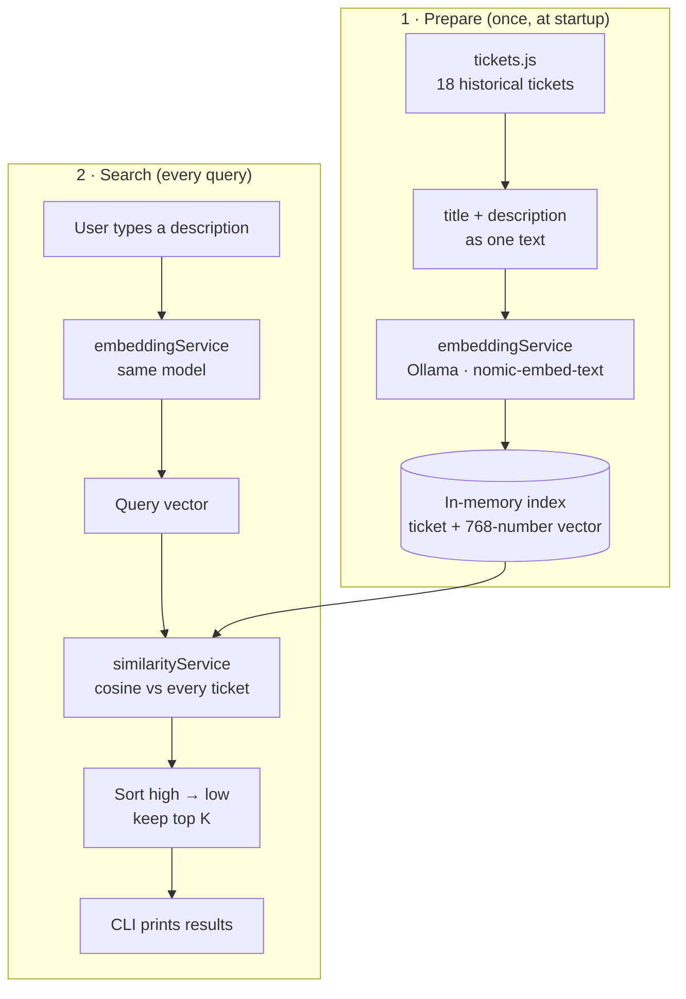

# Similar Ticket Search

Find historical support tickets that mean the same thing as a new ticket — even when they use different words — using **embeddings** and **cosine similarity**.

> Scope: semantic search only. No RAG, no LLM-generated answers, no vector database.

## The problem

Keyword search matches words. These two tickets describe the same problem but share almost no words:

- *"My Wi-Fi keeps disconnecting."*
- *"Wireless signal lost repeatedly."*

Semantic search compares **meaning** instead. Each text is turned into a list of numbers (an embedding), and texts with similar meaning get similar numbers.

## How it works



1. **Prepare.** Each ticket's title and description are joined into one text and sent to the embedding model, which returns 768 numbers. The ticket and its vector are kept in memory.
2. **Search.** The query is embedded with the **same model**, compared against every stored vector with cosine similarity, sorted, and the top K are returned.

The same model must be used for both steps: every model has its own "coordinate system", so vectors from different models cannot be compared.

## Embeddings

An **embedding** is a list of numbers (here, 768) that represents the meaning of a piece of text. The model learned, from huge amounts of text, to place texts with similar meaning close together in this 768-dimensional space.

- *"Internet keeps cutting out"* and *"Frequent Wi-Fi disconnections"* land near each other.
- *"Charged twice this month"* lands far away.

Individual numbers have no human meaning — dimension 42 is not "the Wi-Fi dimension". Meaning is spread across all dimensions together; only the **overall direction** of the vector is useful.

## Cosine similarity

Measures whether two vectors point in the same direction:

```
cosine(A, B) = (A · B) / (‖A‖ × ‖B‖)
```

Worked example with 3 numbers:

| | Value |
|---|---|
| A | [1, 2, 3] |
| B | [2, 4, 5] |
| A · B (dot product) | 1×2 + 2×4 + 3×5 = **25** |
| ‖A‖ (length) | √(1+4+9) = √14 ≈ **3.742** |
| ‖B‖ (length) | √(4+16+25) = √45 ≈ **6.708** |
| cosine | 25 / (3.742 × 6.708) ≈ **0.996** |

A zero vector has no direction, so the function returns `0` instead of dividing by zero. Vectors of different lengths throw an error.

### Reading the score

| Score | Meaning |
|---|---|
| close to 1 | same direction — very similar meaning |
| around 0 | unrelated |
| close to -1 | opposite direction (rare with text embeddings) |

**A score is not a probability.** `0.85` does not mean "85% chance it is the same issue". Scores are only meaningful **relative to each other** for the same model. With `nomic-embed-text`, even unrelated support tickets often score 0.4–0.5, because they are all short English customer-support sentences.

## Tech stack

| | |
|---|---|
| Language | JavaScript (CommonJS), types via JSDoc + `jsconfig.json` |
| Runtime | Node.js ≥ 22.9 (built-in `fetch`, `--env-file`, `node:test`) |
| Embedding API | [Ollama](https://ollama.com), local, no API key |
| Embedding model | `nomic-embed-text` (768 dimensions) |
| Similarity | Cosine similarity, hand-written |
| Storage | In-memory array |
| Runtime dependencies | None |

## Project structure

```
├── src/
│   ├── data/tickets.js                   18 sample tickets (data only)
│   ├── types/ticket.js                   JSDoc types: Ticket, IndexedTicket, SearchResult
│   ├── services/
│   │   ├── embeddingService.js           text → vector via Ollama; caching; validation
│   │   ├── similarityService.js          cosine similarity (pure math)
│   │   └── semanticSearchService.js      build index, search, rank, top K
│   ├── index.js                          command-line interface
│   └── server.js                         HTTP server: static page + /api/search
├── public/                               web frontend (index.html, styles.css, app.js)
├── test/
│   ├── similarityService.test.js         the math and its edge cases
│   ├── embeddingService.test.js          API failures, bad responses, caching (fake fetch)
│   ├── semanticSearchService.test.js     ranking, K, empty inputs (fake embedder)
│   └── relevance.integration.test.js     real model: does each query hit the right category?
├── .env.example
├── jsconfig.json
└── package.json
```

Only `embeddingService.js` talks to Ollama. Switching to OpenAI or Gemini means editing that one file.

## Setup

1. Install [Ollama](https://ollama.com) and pull the embedding model:
   ```bash
   ollama pull nomic-embed-text
   ```
2. Install dev tooling (type definitions only) and create your env file:
   ```bash
   npm install
   cp .env.example .env
   ```

| Variable | Default | Purpose |
|---|---|---|
| `OLLAMA_BASE_URL` | `http://localhost:11434` | Where Ollama is running |
| `OLLAMA_EMBEDDING_MODEL` | `nomic-embed-text` | Model used for tickets **and** queries |

No API key is needed for local Ollama. If you switch to a hosted provider, keep the key in `.env` (which is git-ignored) and only use it server-side.

## Running

### Command-line interface

```bash
npm start                                   # interactive: type queries, "exit" to quit
npm start -- "My Wi-Fi keeps dropping"      # one search
npm start -- --k 5 "I was charged twice"    # top 5 instead of top 3
npm test                                    # all tests (integration test skips if Ollama is down)
```

### Web server (with RAG)

```bash
npm run serve                               # http://localhost:3000
```

The page has two buttons:
- **Search:** finds similar tickets (semantic search)
- **Search + Generate:** finds similar tickets + generates a response (RAG)

### Web frontend

```bash
npm run serve        # then open http://localhost:3000 (or the PORT in .env)
```

The page (`public/index.html`, `styles.css`, `app.js`) calls the app's own `POST /api/search` endpoint. Only the server talks to Ollama. `src/server.js` builds the index once at startup and reuses it for every search.

| Endpoint | Body / response |
|---|---|
| `GET /api/health` | `{ status, indexedTickets, model }` |
| `POST /api/search` | body `{ query: string, k?: 1–10 }` → `{ query, model, results: [ticket + similarity] }` |

Example CLI output:

```
Indexed 18 tickets in 1363 ms.

Top 3 matches for: "The Wi-Fi connection drops repeatedly."

1. [0.863] TICKET-101 — Frequent Wi-Fi disconnections
   The Wi-Fi connection drops every few minutes, and I need to reconnect.
   Connectivity · Resolved

2. [0.695] TICKET-103 — Wireless signal lost repeatedly
   Laptops and phones keep losing the wireless network, especially in the evening.
   Connectivity · Resolved

3. [0.657] TICKET-102 — Internet keeps cutting out
   My internet goes down for a minute or two several times an hour, then comes back on its own.
   Connectivity · Resolved
```

## Example queries and actual top 3

| Query | Top 3 |
|---|---|
| My internet keeps disconnecting. | 102 cutting out (0.85), 101 Wi-Fi disconnections (0.78), 104 no internet (0.68) |
| The Wi-Fi connection drops repeatedly. | 101 (0.86), 103 wireless lost (0.70), 102 (0.66) |
| I cannot make a payment. | 112 can't pay in app (0.73), 111 card declined (0.70), 113 autopay failed (0.64) |
| My internet is extremely slow. | 105 slow speed (0.78), **102 cutting out (0.74)**, 104 no internet (0.64) |
| I cannot log in to my account. | 116 forgot password (0.76), 117 account locked (0.73), 118 2FA code (0.59) |

Note the slow-internet query: a *disconnection* ticket ranks above *"Videos buffering constantly"* (106) and *"Downloads are crawling"* (107). The model weighs the shared phrase "my internet" heavily, while 106/107 describe slowness without saying "internet". This is a typical semantic-search failure.

## Evaluating relevance

You can't eyeball every query, so build a small **labelled set**: queries paired with the tickets a human says are correct. Then measure:

- **Hit@1** — is the best result relevant? (`relevance.integration.test.js` checks this by category.)
- **Recall@K** — of the relevant tickets, how many appear in the top K?
- **Score gap** — how far apart are the last relevant and first irrelevant scores? A small gap means fragile ranking.

Re-run the set whenever you change the model, the ticket text format, or the dataset.

## Limitations

- **Not always right.** Shared surface words ("internet") can outweigh the actual symptom ("slow" vs "dropping").
- **Scores are relative.** There is no universal "similar enough" threshold; one must be tuned per model and dataset.
- **Re-embeds on every start.** The cache lives in memory only. Fine for 18 tickets, slow for 100,000.
- **Linear scan.** Every query is compared to every ticket — O(n). Fine to thousands, not millions.
- **No keyword precision.** Exact identifiers (error codes, invoice numbers, IP addresses) are matched poorly.
- **One language, short texts.** Long tickets get compressed into one vector and lose detail.

## RAG: Retrieval-Augmented Generation

RAG is now implemented. See [RAG_IMPLEMENTATION.md](RAG_IMPLEMENTATION.md) for a detailed step-by-step explanation.

**What it does:**
1. Find similar tickets (semantic search)
2. Format them as context
3. Send to LLM (llama2) with a prompt
4. LLM generates a helpful response
5. Show both the response and the tickets it was based on

**Try it:** Click "Search + Generate" on the web page.

---

## Future improvements

- Persist embeddings to a JSON file, keyed by a hash of ticket text + model name, so restarts are instant.
- Add `nomic-embed-text`'s task prefixes (`search_document:` / `search_query:`) and measure whether ranking improves.
- Hybrid search: combine cosine similarity with keyword scoring (BM25) for exact terms.
- Filter by category or status before ranking (e.g. only resolved tickets).
- A vector database (pgvector, Qdrant) once the dataset is too large for a linear scan.
- Evaluate generated responses: build a test set of good/bad LLM outputs and measure quality.
